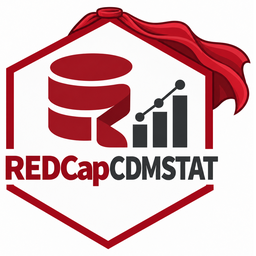

<p align="center"></p>

# REDCap CDMSTAT

Clinical data management (CDM) **and** statistical analysis (STAT) on one
engine, for studies in **REDCap**, **REDCap Cloud** or any EDC that exports
**CDISC ODM**. It is delivered four ways: an R package, a Shiny app, a
standalone web app (JavaScript + Python gateway + R engine) and a Quarto
report template. Everything runs against a simulated randomised trial out of
the box, so you can try it without a server or token.

```
 REDCap (API + DET)     REDCap Cloud (REST, ODM)     Any EDC (ODM 1.3 file)
        │                        │                           │
        └──────── RedcapBackend / RedcapCloudBackend / OdmBackend ───────┘
                                  │  incremental sync, write-back
┌────────────────────── REDCapCDMSTAT (R package) ──────────────────────┐
│ DATA     sync + dictionary drift, live branching/calc logic, ODM I/O │
│ QUALITY  rules, query lifecycle + audit, auto-resolve, write-back    │
│ CDMS     randomisation, SDV, locks, e-signatures, medical coding,    │
│          protocol deviations, site metrics, activity trail           │
│ STAT     wrangling, Table 1, outliers, trends, lm/glm/Cox, data cuts │
│ EXPORT   CDISC SDTM (DM, VS, LB, AE; CSV + XPT), ODM, replay script  │
│ ledger   SQLite: everything above, shared by every interface         │
└───────▲───────────────────▲─────────────────────▲─────────────────────┘
   Shiny app          plumber API (localhost)   Quarto / R Markdown report
   inst/app           inst/api                  inst/quarto
                            ▲
                     FastAPI gateway: users + roles, e-sign re-auth,
                     WebSocket push, REDCap DET endpoint (web/gateway)
                            ▲
                     Web frontend (web/static)

 REDCap Data Resolution Workflow  <──two-way──>  query ledger
   via the CDMSTAT DRW External Module (redcap-module/cdmstat_drw_v1.0.0)
```

## REDCap Cloud capabilities covered

REDCap Cloud (nPhase) is a commercial EDC/CDMS, separate from Vanderbilt's
REDCap. CDMSTAT connects to it and provides its data-management capabilities
on top of either platform:

| REDCap Cloud capability | In CDMSTAT |
|---|---|
| EDC / CDMS data access | `cdmstat_cloud()` pulls the study over the REST API as CDISC ODM; `cdmstat_odm()` reads any ODM export. Incremental sync works on both because subjects are change-detected by hash. |
| Randomisation | Stratified permuted-block schedule (`setup_randomization`), concealed allocation, one allocation per subject, arm written back to the EDC, full audit. |
| Query management | Rule-driven and analysis-driven queries, an open → answered → resolved → closed lifecycle with reasons, and auto-resolution. On REDCap they are mirrored two-way into the native **Data Resolution Workflow** (see below). |
| Source data verification | Risk-based SDV plan: critical fields 100%, first N subjects per site, and a random sample. Monitors verify units; edited units return to *reverify*. On REDCap, verified values are also marked verified in the DRW. |
| Record locking | Lock a record, event or form. On REDCap the forms are locked in REDCap itself through the External Module, so edits are refused; changes on other EDCs raise an error-level issue. Unlocking needs a reason. |
| 21 CFR Part 11 e-signatures | The signature binds signer, meaning and a hash of the data, and is flagged invalid if the data later change. The gateway re-authenticates the signer's credential before signing. |
| Medical coding | Exact and synonym auto-coding, a fuzzy-match review queue and coder approval. Ships a demo dictionary with fictitious codes; load your licensed MedDRA / WHODrug export. |
| Protocol deviations | Manual log plus automatic out-of-window visit detection from the event schedule, with major/minor severity and closure comments. |
| Portfolio / site oversight | Per-site metrics (subjects, randomised, open queries, query age, time to resolution, SDV %, deviations) and enrolment curves; `cdmstat_portfolio()` / `run_portfolio()` compare several studies. |
| Audit trail | Append-only activity trail for every CDMS action, plus a query audit, a sync log and dictionary drift history. |
| CDISC standards | SDTM DM, VS, LB, AE, SV and DS (CSV and SAS transport `.xpt`) with a Define-XML 2.0 file; AEDECOD is taken from coding. ODM 1.3 export/import. |
| Role-based access | Gateway roles: `dm`, `stats`, `monitor`, `pi`, `viewer`. |

Not replicated: eConsent, ePRO/eCOA and eRecruitment. These are
participant-facing data capture and stay in REDCap / REDCap Cloud; their data
flow into CDMSTAT like any other form.

## How the analysis gaps are closed

| Gap | What CDMSTAT does |
|---|---|
| Analysis and DM are separate | Click an outlier on a plot (Shiny or web) and the query lands in the DM ledger. Rule queries auto-resolve when the data is fixed in the EDC. |
| Pull-and-cache, stale data | Incremental sync re-exports only changed records (REDCap log or ODM hashes); a REDCap Data Entry Trigger patches one record within seconds. |
| Stale branching/calc logic | Logic is compiled from the **live** dictionary on every run. The dictionary is hashed on each sync, so design changes are caught and diffed. |
| Passive metadata | Wrangle view: long or wide by event, drop, collapse or isolate repeating forms, with the variable list shown immediately. |
| Hours of Table 1 code | Arm and baseline variables are detected from the dictionary; tests are chosen from normality and expected counts, with a rationale column; SAP mode enforces pre-specified tests. |
| Reproducibility | Every analytic step is logged as R code (`nx$script()`); analyses can be pinned to a hashed, signed-off data cut. |
| Token safety | Tokens come from an environment variable or the OS keyring (the store `rccola` uses), never from the cache, ledger or scripts. |

## REDCap Data Resolution Workflow (native queries)

[redcap-module/cdmstat_drw_v1.0.0](redcap-module/cdmstat_drw_v1.0.0/README.md)
is a REDCap External Module that adds Module API actions for the DRW. With it
installed and `nx$drw_enable()` run:

- **Push:** CDMSTAT queries appear in REDCap's DRW pop-up and resolve
  dashboard for site staff, and CDMSTAT status changes are mirrored there.
- **Pull:** responses, closures and reopenings made in REDCap flow back into
  the ledger, attributed to `redcap:<username>`. Queries opened directly in
  REDCap are imported.

Sync runs after every `nx$sync()`. You can also run it from the Queries tab
in Shiny or the web app, or call `nx$drw_sync()`. With the default options,
`nx$lock()` also locks the forms inside REDCap, and `nx$sdv_verify()` marks
the values verified in the DRW; turn these off with
`nx$drw_enable(lock_in_edc = FALSE, verify_sdv = FALSE)`. The module checks
DRW and locking rights per action, refuses to write if REDCap's schema is not
what it expects, and logs every write to REDCap's project Logging.

## 1. R package

```r
install.packages("REDCapCDMSTAT", repos = NULL, type = "source")   # from this folder
library(REDCapCDMSTAT)

nx <- cdmstat_demo()                                   # simulated trial
# nx <- cdmstat_connect("https://redcap.example.org/api/", keyring_service = "redcap_pid_1234")
# nx <- cdmstat_cloud("https://<your-instance>.redcapcloud.com", study = "TRIAL-7",
#                     token_env = "REDCAP_CLOUD_TOKEN",
#                     export_path = "<ODM export path from your REDCap Cloud API docs>")
# nx <- cdmstat_odm("study_export.xml")                # any EDC

# Data quality and queries
nx$sync(); nx$validate(); nx$raise_queries()
nx$add_rule("sbp_gt_dbp", "[sbp] > [dbp]", "SBP must exceed DBP", "error")

# CDMS
nx$setup_randomization(strata = c("site", "sex"), block_sizes = c(4, 6))
nx$randomize("121")
nx$sdv_plan(critical_fields = c("arm", "ae_serious"), first_n = 3, sample_rate = 0.2)
nx$sdv_verify("1|baseline_arm_1|vitals|")
lk <- nx$lock("10", "Database lock"); nx$esign("10", "I approve as PI", identity_verified = TRUE)
nx$load_dictionary("meddra_llt.csv")                   # code, term, synonyms
nx$code_terms("ae_term"); nx$approve_coding(key)
nx$check_visit_windows(window = 7); nx$site_metrics()

# Statistics, reproducibility and export
nx$table_one(); nx$trend("sbp"); nx$fit("Surv(followup_days, event_occurred == 'Yes') ~ arm", "cox")
nx$fit("sbp ~ arm * redcap_event_name + (1 | record_id)", "mixed")   # repeated measures
cut <- nx$freeze("Interim 1"); nx$sign_off(cut, "Data clean"); nx$use_cut(cut, require_signoff = TRUE)
nx$export_cdisc("cdisc_out")                           # SDTM .csv + .xpt, define.xml, study.odm.xml
cat(nx$script())

# Several studies side by side
cdmstat_portfolio(list(trial_a = nx, trial_b = "/path/to/other/cache"))
```

Every exported function and class has a help page (`?CDMSTAT`,
`?cdmstat_connect`, `?table_one` and so on), and `R CMD check` passes with no
errors, warnings or notes.

Run the tests with `testthat::test_local("REDCapCDMSTAT")`: 179
expectations, including a mock REDCap Cloud server, the DRW sync and REDCap
locking. Run the External Module's own tests with
`php redcap-module/cdmstat_drw_v1.0.0/tests/run_tests.php` (44 checks).

## 2. Shiny app

```r
REDCapCDMSTAT::run_app()
```

Main tabs: Overview, Data quality, Queries, Explore (click-to-query),
Wrangle, Statistics (Table 1, trends, and a model builder with linear,
logistic, Cox and mixed models), Data cuts and Script. A **CDMS** menu holds
Randomization, SDV, Locks & e-signatures, Medical coding, Deviations,
Site metrics, CDISC export and Activity trail. Each browser session has its
own engine, so choosing a data cut affects only that user.

For several studies, run `REDCapCDMSTAT::run_portfolio(c(trial_a = "<dir>", trial_b = "<dir>"))`.

## 3. Standalone web app

```powershell
pip install -r web/gateway/requirements.txt
cd web; .\run.ps1          # Linux/macOS: ./run.sh
```

On first run this creates a `data_manager` and a `statistician` key, which
are printed once. Add other people with
`python web/gateway/manage_users.py add <name> <dm|stats|monitor|pi|viewer>`.

| Role | Can |
|---|---|
| `dm` | everything except SDV verification and signing: queries, rules, cuts, randomisation set-up, locks, coding, deviations |
| `stats` | read, raise analysis queries, comment |
| `monitor` | read, raise queries, verify SDV, log deviations |
| `pi` | read, randomise, e-sign (re-enters their key) |
| `viewer` | read only |

Allocations are visible only to `dm`. The R engine accepts requests only
through the gateway, which holds the shared secret.

## 4. Quarto report

```r
REDCapCDMSTAT::render_report(dir = nx$dir, cut_id = cut, require_signoff = TRUE)
```

It renders with Quarto, then rmarkdown (needs pandoc), then knitr + markdown,
using whichever is available. See `examples/sample-report.html`.

## Validation (IQ/OQ/PQ)

```bash
Rscript validation/run_validation.R /path/to/php
```

This runs the installation checks, the full R test suite and the External
Module tests, and traces each result to the user requirements in
[validation/requirements.csv](validation/requirements.csv). It writes a
signed-off-ready report to `validation/output/`. The latest run passed: 18/18
IQ checks, 41/41 R tests, 44/44 module tests and 24/24 requirements.
Performance qualification on your own study follows
[validation/PQ-protocol.md](validation/PQ-protocol.md).

## Deployment

[deploy/](deploy/README.md) has nginx and Caddy HTTPS configs, systemd units,
an environment template and a security checklist covering encrypted storage,
backups, secrets and log redaction.

## Configuration (app and API)

| Variable | Meaning |
|---|---|
| `CDMSTAT_SOURCE` | `demo` (default), `redcap`, `cloud`, `odm` |
| `CDMSTAT_URL` | REDCap API URL, or REDCap Cloud base URL |
| `CDMSTAT_TOKEN_ENV` | env var holding the token (`REDCAP_API_TOKEN` / `REDCAP_CLOUD_TOKEN`) |
| `CDMSTAT_KEYRING_SERVICE` | read the token from the OS keyring instead |
| `CDMSTAT_STUDY`, `CDMSTAT_EXPORT_PATH`, `CDMSTAT_IMPORT_PATH`, `CDMSTAT_AUTH_HEADER`, `CDMSTAT_AUTH_PREFIX` | REDCap Cloud endpoint settings |
| `CDMSTAT_ODM_FILE` | ODM file for `odm` source |
| `CDMSTAT_DIR` | cache + ledger folder shared by app, API and reports |
| `CDMSTAT_GATEWAY_SECRET`, `CDMSTAT_DET_TOKEN`, `CDMSTAT_USERS_FILE` | gateway security |

## Known limits

- **REDCap Cloud API paths:** REDCap Cloud documents its REST API inside each customer account, not publicly. The connector is tested against a mock server; set `export_path` / `import_path` / the auth header from your instance's API documentation.
- **MedDRA / WHODrug** are licensed and not bundled. The demo dictionary's codes are fictitious.
- **DRW External Module not yet run on a live REDCap.** It has been tested against a stub framework and SQLite copies of the DRW and locking tables. Install it on a development REDCap copy first (PQ-05 to PQ-09) and confirm that threads and locks display correctly. It handles field-level queries, verification and form locks, not Data Quality rule discrepancies or file attachments.
- **E-signatures are not written into REDCap.** REDCap's own e-signature requires the signer's REDCap password, so CDMSTAT signatures stay in its ledger, bound to a hash of the data.
- **On REDCap Cloud and ODM sources, locks are detect-only.** Edits after a lock are flagged, not blocked.
- **SDTM mapping is guessed from field names** (`sdtm_default_map()`); real studies need it reviewed. define.xml has dataset and variable metadata but no controlled-terminology code lists. Run a conformance checker before submission.
- **The cache holds identifiable data.** Follow the [deployment security checklist](deploy/README.md#security-checklist). PQ on your own study (validation/PQ-protocol.md) is the deploying organisation's responsibility.
