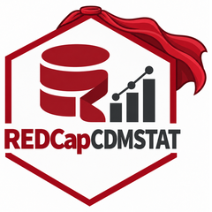
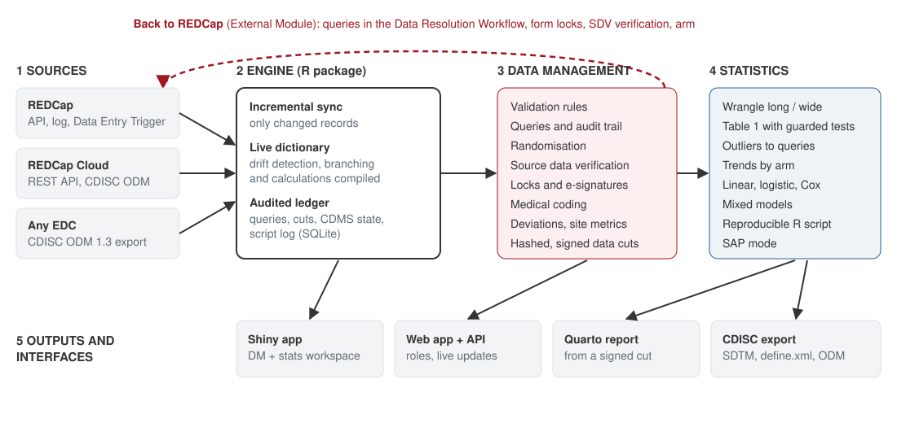

# REDCapCDMSTAT 

<!-- badges: start -->
[](https://github.com/neu-data/REDCapCDMSTAT/actions/workflows/R-CMD-check.yaml)
[](https://neu-data.github.io/REDCapCDMSTAT/)


<!-- badges: end -->

**Clinical data management (CDM) and statistical analysis (STAT) on one
engine**, for studies in REDCap, REDCap Cloud, or any EDC that exports
CDISC ODM.

Data managers and biostatisticians usually work in separate tools: queries
live in one place, analysis scripts in another, and outliers found in a model
are typed back into REDCap by hand. REDCapCDMSTAT puts both on the same
audited ledger. A point clicked on a scatterplot becomes a query in REDCap's
own query pop-up. A corrected value closes that query on the next sync. An
analysis runs on a hashed, signed-off data cut, and every step can be
replayed as an R script.



## What is in the box

| Component | For | Where |
|---|---|---|
| **R package** | The engine: sync, rules, queries, CDMS modules, statistics, CDISC export, reproducible scripts | this package |
| **Shiny app** | One workspace for data managers and statisticians | `run_app()` |
| **Web app, gateway and REST API** | Multi-user access with roles, live updates and the REDCap Data Entry Trigger | `web/` and `run_api()` |
| **Portfolio dashboard** | Several studies side by side | `run_portfolio()` |
| **Quarto report** | Reproducible analysis report from a signed data cut | `render_report()` |
| **REDCap External Module** | Native Data Resolution Workflow queries, form locks and verification over the REDCap API | `redcap-module/` |
| **Validation pack and deployment kit** | IQ/OQ runner, traceability matrix, PQ protocol, HTTPS configs | `validation/`, `deploy/` |

## Installation

```r
# install.packages("pak")
pak::pak("neu-data/REDCapCDMSTAT/REDCapCDMSTAT")
```

The package lives in the `REDCapCDMSTAT/` folder of the
[repository](https://github.com/neu-data/REDCapCDMSTAT). The web app, the
External Module and the deployment files sit alongside it.

## Try it in one minute

Everything runs on a simulated two-arm trial (120 subjects, three visits, a
repeating adverse-event form and planted data errors), so you need no server
and no token:

```r
library(REDCapCDMSTAT)
nx <- cdmstat_demo()

nx$validate()              # rule violations from the live data dictionary
nx$raise_queries()         # into the audited query ledger
nx$table_one()             # arm and baseline variables detected automatically
nx$fit("sbp ~ arm * redcap_event_name + (1 | record_id)", "mixed")

run_app()                  # the same project in the Shiny app
```

## Connect your own REDCap project

```r
redcap_check("https://redcap.your-institution.org/api/", token = "<token>")  # read-only diagnosis
nx <- cdmstat_setup("https://redcap.your-institution.org/api/")             # prompts for the token
```

See [Connect your REDCap project](https://neu-data.github.io/REDCapCDMSTAT/articles/connect-redcap.html).

## How it compares

REDCapCDMSTAT builds on the ideas of excellent existing packages (redcapAPI,
REDCapR, REDCapTidieR, tidyREDCap, REDCapDM, REDCapSync, RosyREDCap). It
adds the last mile between them: live dictionary logic, a bi-directional
query loop with REDCap, CDMS modules, and statistics on audited data cuts. See
the [capability comparison](https://neu-data.github.io/REDCapCDMSTAT/articles/comparison.html).

## Status

Tested against a simulated REDCap project, a mock REDCap API server and a
stand-in for the External Module framework: 210 R test expectations, 44
module checks, and 25 user requirements traced by the validation pack. It
has not yet been run against a live REDCap server. Run the performance
qualification on a development copy of your project before use in a
regulated study.

---

Developed by [**Neudata Consulting Ltd**](https://www.neu-data.com) · *Insight. Impact. Innovation.*
